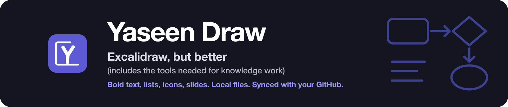
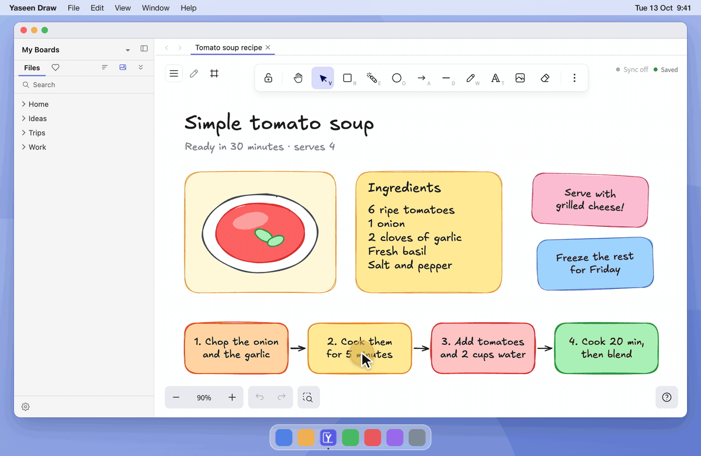
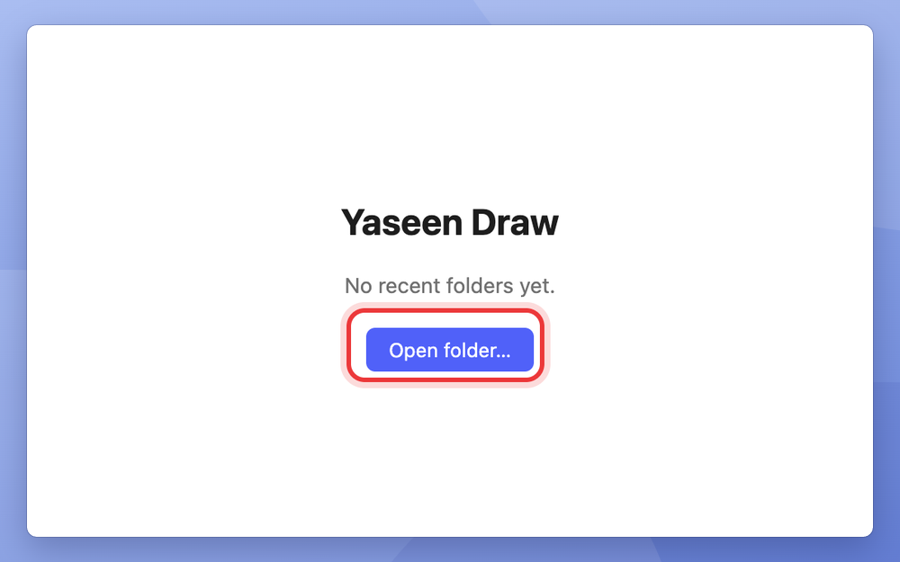
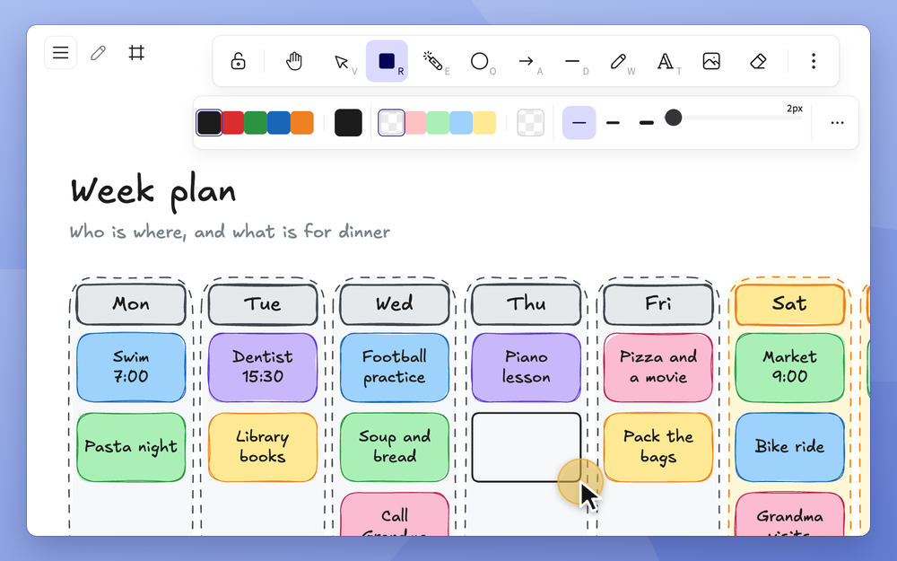
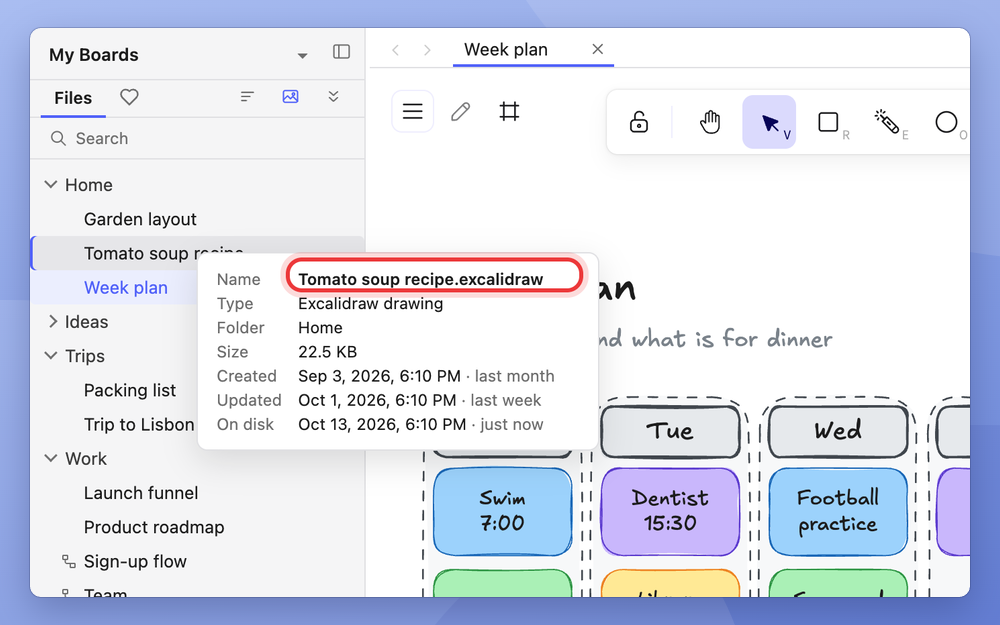
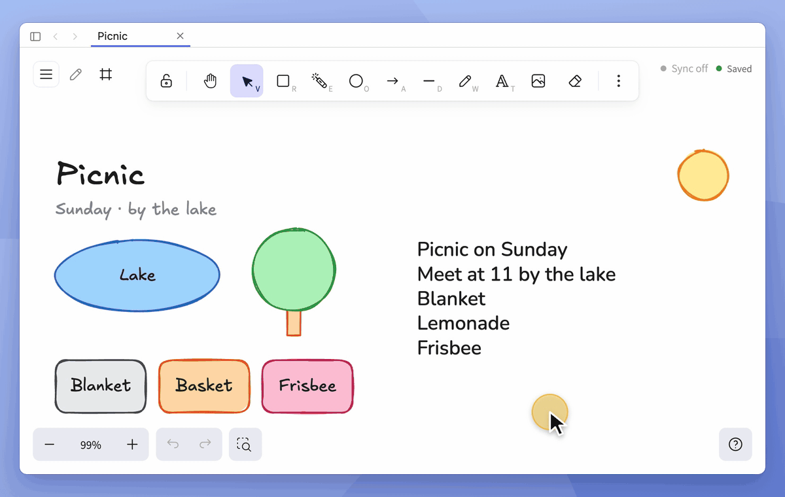
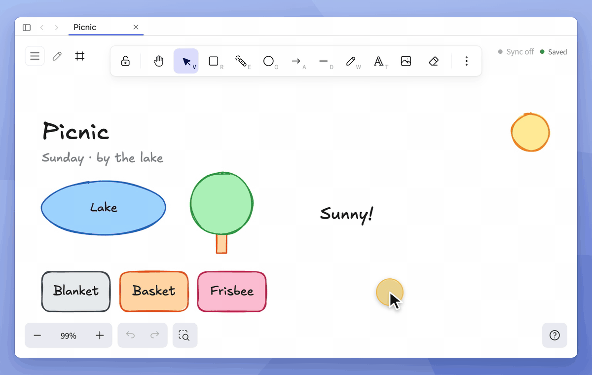
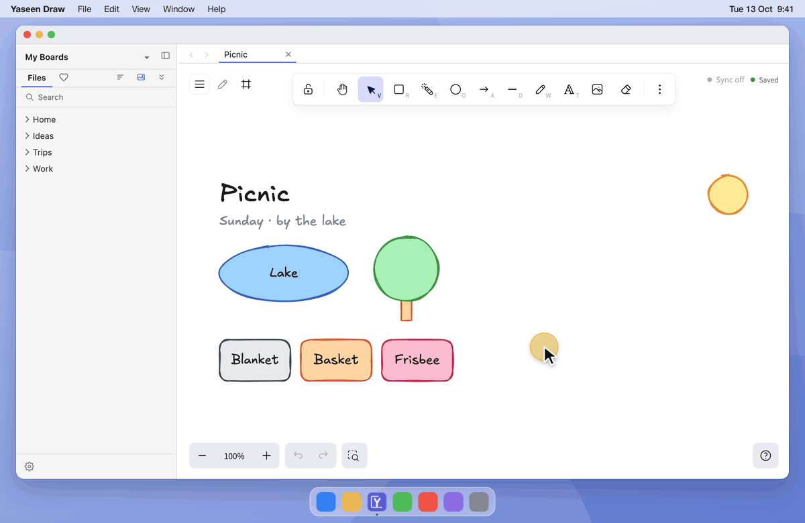
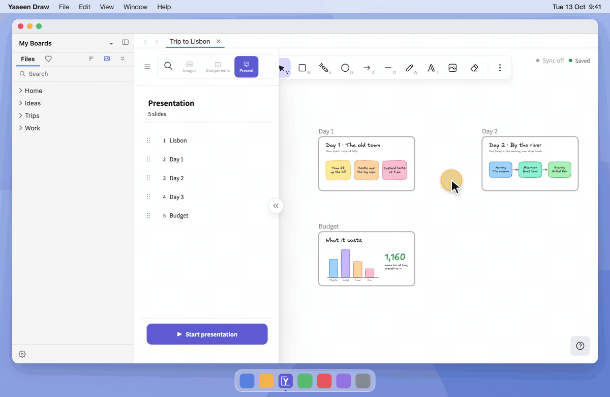
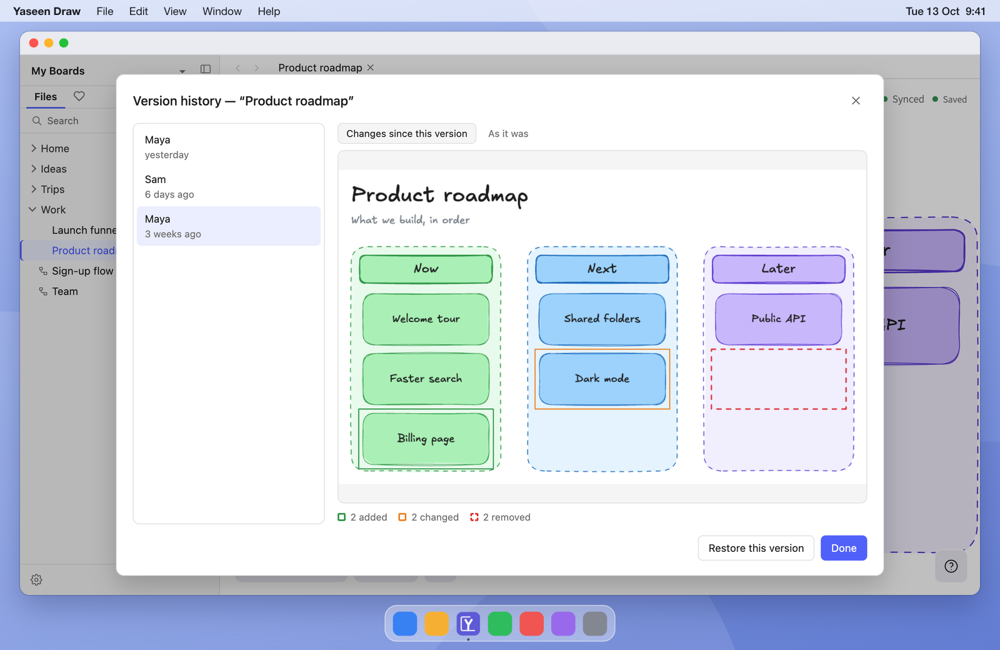

  

  
  
  

  <b><a href="https://github.com/yaseenarshad/yaseen-draw-app/releases/latest">Download</a></b>
  &nbsp;·&nbsp;
  <a href="#how-it-works">How it works</a>
  &nbsp;·&nbsp;
  <a href="#questions">Questions</a>
  &nbsp;·&nbsp;
  <a href="docs/GUIDE.md">Feature guide</a>

<h3 align="center">Write on a whiteboard like in a document. Own each board as a file.</h3>

  

  <b><a href="https://github.com/yaseenarshad/yaseen-draw-app/releases/latest">Download for Mac or Windows</a></b> 
  Free. No account. Works offline.

## How is this different from Excalidraw?

I think in Excalidraw all day. But each time I wrote real notes on a board, I missed the basics: bold, a list, an icon. So I built them in. Then I made each board a file on my own computer, synced to my own GitHub.

Maybe you know this. Excalidraw is the fastest way to sketch an idea. But you write on the board, too. And then:

- You want one line in bold. There is no bold.
- You want a list. You type each dash by hand.
- You want an icon. You leave the board to look for one.
- You want to show the board. You export pictures into a slide app.
- You close the browser tab, and you hope that the board is there tomorrow.

Yaseen Draw is Excalidraw with those tools built in. Each board is a plain file on your own computer, and it syncs to your own GitHub.

The app is built on the open-source code of Excalidraw. The pen, the shapes and the hand-drawn look are the same.

## How it works

<table>
  <tr>
    <td width="33%" valign="top">
       
      <b>1. Pick a folder.</b> 
      Any folder on your computer. An empty folder is fine.
    </td>
    <td width="33%" valign="top">
       
      <b>2. Draw and write.</b> 
      The app saves each change while you work.
    </td>
    <td width="33%" valign="top">
       
      <b>3. The board is a file.</b> 
      You name it, move it, and put it in folders, the same as any file.
    </td>
  </tr>
</table>

## What you can do

### Format text like in a document

Make a line bold, underlined, or struck through. Turn lines into a bulleted list or a numbered list. Set the exact size and the line spacing. Put a colour behind a note.

**So what:** your board reads like a page, not like a pile of labels.

A style applies to a full line, or to the full text box. Bold shows best in the Normal font.

### Colour and size with one key

Select a shape and press `R`. The shape is red. Press `⇧U` for a blue outline. Select a text and press a number key to set its size.

**So what:** your hands stay on the keys, and your mind stays on the idea.

### Add an icon without leaving the board

Press `⌘F`, type a word, and click a result. The icon is on your board. The search uses Iconify, and Pixabay if you add your own free key.

**So what:** you stop the hunt through browser tabs for one small picture.

### Present from the board

Each frame on a board is a slide. Click **Start presentation** and go through the frames with the arrow keys. There is no export and no second app.

**So what:** the board you think on is the board you show.

### Keep each board as a file, synced to your own GitHub

Your boards are files in folders on your computer. Turn on sync, and the folder goes to your own GitHub repo. It works like a cloud drive, but the drive is yours.

Two computers can use the same folder. If the two change one drawing, the app merges it shape by shape. And the app keeps each old version as a picture: green shows what you added, amber shows what you changed, and red shows what you removed.

**So what:** you get the backup and the history of a cloud drive, and the files stay on your disk.

### And the small things

- **Find a board in seconds.** Folders in the sidebar, boards in tabs, a preview when you hold the pointer on a board, and `⌘K` to go to a board by name.
- **draw.io in the same app.** Clean diagrams are in the same folder and the same window as your sketches.
- **Share a board with one link.** The link runs on your own free Cloudflare account, and it shows your changes about ten seconds after you stop drawing.
- **A laser pointer that can keep its marks.** The marks fade, hold, or stay on the board.
- **Smart shapes.** Arrows, braces and callouts with handles to adjust them.
- **Exact numbers.** Set the exact line width and the exact corner radius. Give a picture a border and round corners.
- **Your AI agent can draw.** A board is a plain file. An agent or a script writes the file, and the app shows the change at once.

All of it is in the **[feature guide](docs/GUIDE.md)**.

## Side by side

"Excalidraw" here is the free editor on excalidraw.com, compared with its open-source code of July 2026.

| | Excalidraw | Yaseen Draw |
|---|---|---|
| Bold, underline, strikethrough | No | Yes, for a line or a text box |
| Bulleted and numbered lists | No | Yes |
| Font size | Four sizes | Any size from 1 to 512 |
| Line spacing | No control | Yes, from 0.8 to 3 |
| A colour behind text | No | Yes |
| Colour and size with one key | No | Yes |
| Icon and image search | No | Yes |
| Line width | Three widths | Any width from 0.5 to 100 |
| Present the frames as slides | Not in the free editor | Yes |
| Laser pointer | The marks fade | The marks fade, hold, or stay |
| Where a board is kept | In your browser, until you save a file by hand | A file in your folder, saved while you work |
| Folders, tabs, find by name | No | Yes |
| Sync and old versions | Not in the free editor | Yes, with your own GitHub repo |
| draw.io diagrams | No | Yes |

Excalidraw has three things that this app does not have: live collaboration, AI that makes a diagram from text, and the public library of shapes.

## The numbers

Each number is measured. None is an estimate.

| | |
|---|---|
| Download size (version 0.1.13) | 116 MB for Mac, 132 MB for Windows |
| From the start of the app to a board you can draw on | 0.49 seconds |
| Time to open a draw.io diagram | 0.72 seconds |
| Automatic tests that each version must pass | 2,891 unit tests and 129 full-app tests |

The two times are medians of 7 runs on an M1 Max MacBook Pro, measured on version 0.1.12.

What the app does not need:

- **No account.** There is nothing to sign up for.
- **No server.** The app reads and writes files on your disk.
- **No payment.** There is no paid plan.
- **No tracking.** The app has no analytics. It goes online only for the things you turn on: share links, sync, and image search.

## Questions

**Does it cost money?**
No. Share links and sync use your own free Cloudflare and GitHub accounts. Cloudflare asks for a card before it turns storage on, but the free tier costs $0.

**Why does my computer warn me at the first start?**
The app is not signed with a paid developer certificate. So macOS and Windows ask you to confirm one time. The steps are below.

**Do my boards still open in Excalidraw?**
Yes. Each board is a `.excalidraw` file in your folder, in the format of Excalidraw. The extra styles of this app, such as bold and lists, are not part of Excalidraw. Expect plain text there.

**Does it need the internet?**
No. You draw, find, and present offline. Only share links, sync, and image search go online.

## Download

**[Download the newest version](https://github.com/yaseenarshad/yaseen-draw-app/releases/latest)**

You need a Mac with Apple Silicon, or a Windows PC (x64). There is no build for an Intel Mac or for Linux.

1. Download the `.dmg` file for a Mac, or the `-win-x64-setup.exe` file for Windows.
2. Open the file and install the app.
3. Open the app. The first time, your computer blocks it:
   - **Mac:** open **System Settings › Privacy & Security**, go down to the notice about the app, and click **Open Anyway**.
   - **Windows:** on the "Windows protected your PC" screen, click **More info**, then **Run anyway**.
4. Pick a folder.

You do step 3 only one time. To update, install the newer version over the old one. The app does not update itself.

Then try these three things:

1. Press `T` and type three lines. Select the first line and press `⌘B`. Then click **List**.
2. Select a shape and press `R`.
3. Press `⌘F` and type "rocket".

On Windows, use `Ctrl` in the place of `⌘`.

## For developers

The app is Electron, with a React renderer around a fork of Excalidraw and a bundled, offline draw.io. **[docs/DEVELOPMENT.md](docs/DEVELOPMENT.md)** tells how to build, test, and package it from source.

The licence is [MIT](LICENSE). Yaseen Draw is built on a fork of [Excalidraw](https://excalidraw.com) (MIT). It bundles the [draw.io](https://github.com/jgraph/drawio) webapp (Apache-2.0), not changed. It is not affiliated with either project.
