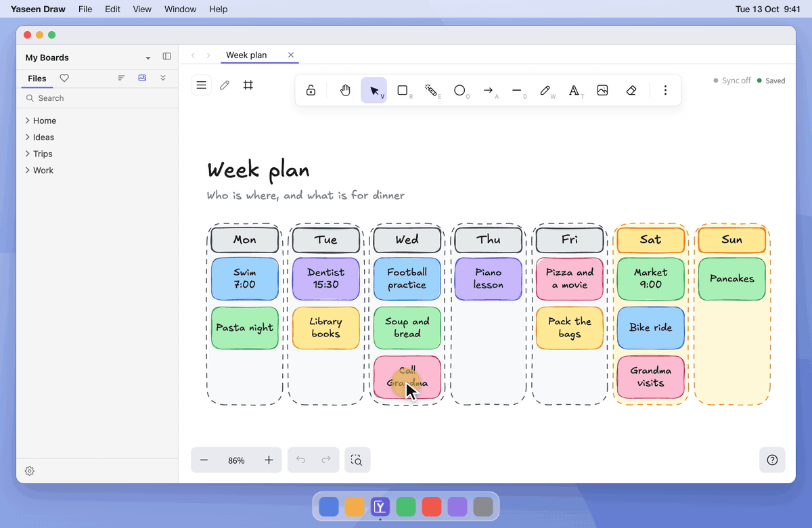
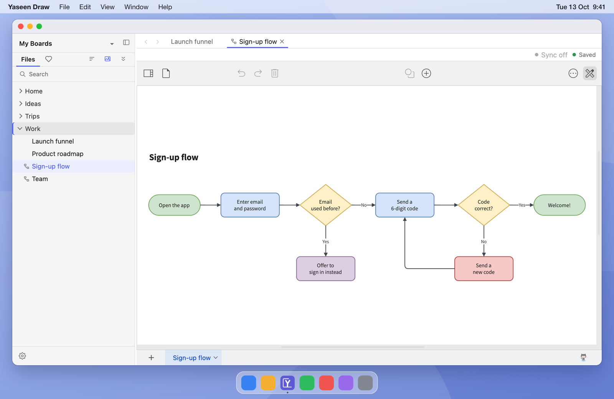
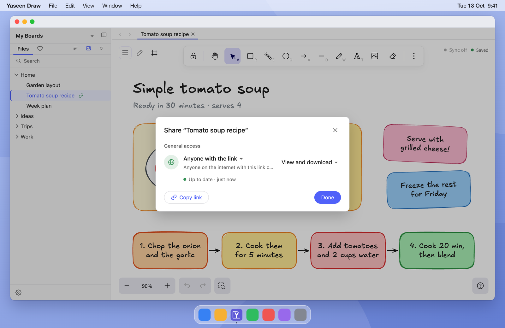

  

  
  
  

  <b><a href="https://github.com/yaseenarshad/yaseen-draw-app/releases/latest">Download</a></b>
  &nbsp;·&nbsp;
  <a href="#how-it-works">How it works</a>
  &nbsp;·&nbsp;
  <a href="#questions">Questions</a>
  &nbsp;·&nbsp;
  <a href="docs/GUIDE.md">Feature guide</a>

<h3 align="center">Find every whiteboard you ever made. Own every one of them.</h3>

  

  <b><a href="https://github.com/yaseenarshad/yaseen-draw-app/releases/latest">Download for Mac or Windows</a></b> 
  Free. No account. Works offline.

## Where is the board you made last month?

I draw a board for almost every idea and every client call. One day a client asked for a diagram from a month before. I knew that I drew it. I did not find it, so I drew it again. That day I started this app.

Maybe you know that moment. You need a board again, and:

- It was in a browser tab. The tab is gone.
- Or it is in a cloud app, behind a login and a monthly bill.
- Or it is one of forty boards with the name "Untitled".
- And your quick sketches are in one app, while your clean diagrams are in a different app.

The board exists. But you cannot find it, and you do not own it.

## How it works

Yaseen Draw keeps each board as one plain file, in a normal folder on your own computer.

<table>
  <tr>
    <td width="33%" valign="top">
       
      <b>1. Pick a folder.</b> 
      Any folder on your computer. An empty folder is fine.
    </td>
    <td width="33%" valign="top">
       
      <b>2. Draw.</b> 
      The app saves each change while you work.
    </td>
    <td width="33%" valign="top">
       
      <b>3. The board is a file.</b> 
      You name it, move it, and put it in folders, the same as any file.
    </td>
  </tr>
</table>

If you know Obsidian, this is the same idea for whiteboards.

## What you can do

### Find a board in seconds

Your folders are in the sidebar. Click a board to open it, or `⌘`-click to open it in a new tab. Hold the pointer on a board to see a preview. Press `⌘K` and type a name to go to a board.

**So what:** the board from last month is two keys away.

### Sketch and make clean diagrams in one app

Excalidraw is for a quick sketch while you think. draw.io is for the clean diagram that goes into a document. The two are in the same folder and the same window.

**So what:** you stop the search through two apps for one picture.

### Share a board with one link

Turn on sharing for a board. You get one link. A person opens it in a browser, with no account and no app. The link shows your changes about ten seconds after you stop drawing.

The link runs on your own free Cloudflare account. Your boards do not go through a server of a different company.

**So what:** you send the link one time, and it is never out of date.

### See each old version as a picture

Open the version history of a board. You see each version drawn out. Green shows what you added, amber shows what you changed, and red shows what you removed. One click puts an old version back.

**So what:** a wrong edit never costs you the board.

### Present from the board

Each frame on a board is a slide. Click **Start presentation** and go through the frames with the arrow keys. There is no export and no second app.

**So what:** the board you think on is the board you show.

### And the small things

- **Two computers, no conflicts.** Sync backs up the folder to your own GitHub repo. If two computers change the same drawing, the app merges it shape by shape.
- **Your AI agent can draw.** A board is a plain file. An agent or a script writes the file, and the app shows the change at once.
- **Git can read it.** Pictures are kept out of the drawing file, so the file stays small and a diff is readable.
- **Nothing is locked in.** A `.excalidraw` file opens on excalidraw.com. A `.drawio` file opens in draw.io.
- **Icon and image search**, reusable components, favorites, a laser pointer, PNG and SVG export, and a dark look.

All of it is in the **[feature guide](docs/GUIDE.md)**.

## The numbers

Each number is measured. None is an estimate.

| | |
|---|---|
| Download size (version 0.1.13) | 116 MB for Mac, 132 MB for Windows |
| From the start of the app to a board you can draw on | 0.49 seconds |
| Time to open a draw.io diagram | 0.72 seconds |
| Automatic tests that each version must pass | 2,891 unit tests and 129 full-app tests |

The two times are medians of 7 runs on an M1 Max MacBook Pro, measured on version 0.1.12.

What the app does not need:

- **No account.** There is nothing to sign up for.
- **No server.** The app reads and writes files on your disk.
- **No payment.** There is no paid plan.
- **No tracking.** The app has no analytics. It goes online only for the things you turn on: share links, sync, and image search.

## Questions

**Does it cost money?**
No. Share links and sync use your own free Cloudflare and GitHub accounts. Cloudflare asks for a card before it turns storage on, but the free tier costs $0.

**Why does my computer warn me at the first start?**
The app is not signed with a paid developer certificate. So macOS and Windows ask you to confirm one time. The steps are below.

**How do I get my boards out?**
They were never in. Each board is a file in your folder, in the format of Excalidraw or draw.io.

**Does it need the internet?**
No. You draw, find, and present offline. Only share links, sync, and image search go online.

## Download

**[Download the newest version](https://github.com/yaseenarshad/yaseen-draw-app/releases/latest)**

You need a Mac with Apple Silicon, or a Windows PC (x64). There is no build for an Intel Mac or for Linux.

1. Download the `.dmg` file for a Mac, or the `-win-x64-setup.exe` file for Windows.
2. Open the file and install the app.
3. Open the app. The first time, your computer blocks it:
   - **Mac:** open **System Settings › Privacy & Security**, go down to the notice about the app, and click **Open Anyway**.
   - **Windows:** on the "Windows protected your PC" screen, click **More info**, then **Run anyway**.
4. Pick a folder.

You do step 3 only one time. To update, install the newer version over the old one. The app does not update itself.

Then try these three things:

1. Right-click the sidebar and select **New Excalidraw drawing**.
2. Press `⌘K` (`Ctrl+K` on Windows) and type the name of a board.
3. Draw two frames on a board. Open the panel at the top left, select **Present**, and click **Start presentation**.

## For developers

The app is Electron, with a React renderer around a fork of Excalidraw and a bundled, offline draw.io. **[docs/DEVELOPMENT.md](docs/DEVELOPMENT.md)** tells how to build, test, and package it from source.

The licence is [MIT](LICENSE). Yaseen Draw is built on a fork of [Excalidraw](https://excalidraw.com) (MIT). It bundles the [draw.io](https://github.com/jgraph/drawio) webapp (Apache-2.0), not changed. It is not affiliated with either project.
